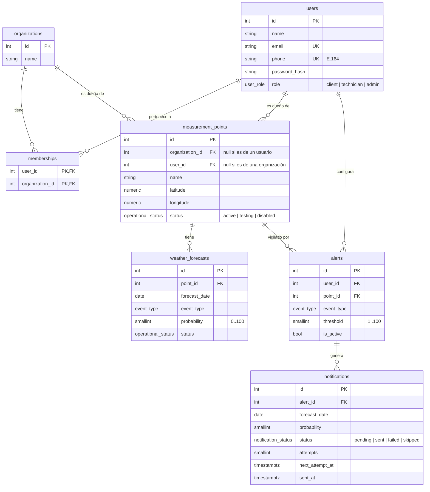
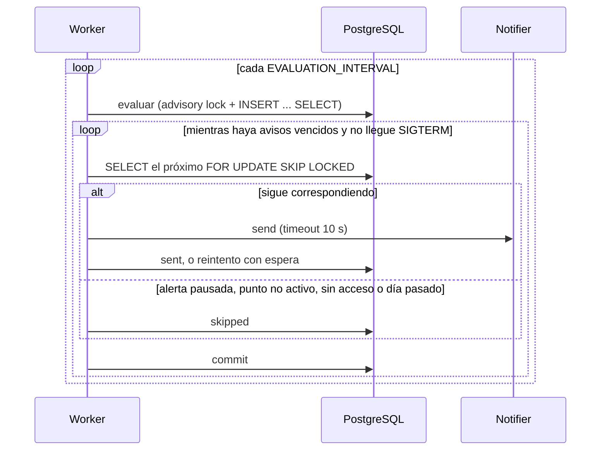

# Diseño

- [Modelo de datos](#modelo-de-datos)
- [Quién ve qué](#quién-ve-qué)
- [Estados de puntos y pronósticos](#estados-de-puntos-y-pronósticos)
- [Evaluación y re-notificación](#evaluación-y-re-notificación)
- [Envío](#envío)
- [Autenticación y roles](#autenticación-y-roles)
- [API](#api)
- [Estructura del código](#estructura-del-código)
- [Supuestos para validar](#supuestos-para-validar)

## Modelo de datos



`users` y `organizations` son una relación muchos a muchos, resuelta con la tabla
`memberships`. Todas las tablas tienen además `created_at` o `updated_at`.

Las reglas que garantiza la base:

| Tabla | Regla | Para qué |
|---|---|---|
| `users` | `UNIQUE(lower(email))`, `UNIQUE(phone)`, `CHECK` E.164 | Identificar al usuario en el login, sin importar mayúsculas |
| `memberships` | PK `(user_id, organization_id)` | Sin membresías repetidas |
| `measurement_points` | `CHECK(num_nonnulls(organization_id, user_id) = 1)` | Exactamente un dueño |
| `measurement_points` | `UNIQUE(organization_id, name)`, `UNIQUE(user_id, name)` | Nombres sin repetir por dueño |
| `weather_forecasts` | `UNIQUE(point_id, forecast_date, event_type)` | Un pronóstico por día y evento; la ingesta hace upsert |
| `alerts` | `UNIQUE(user_id, point_id, event_type)`, `CHECK(threshold BETWEEN 1 AND 100)` | Una alerta por usuario, punto y evento |
| `notifications` | `UNIQUE(alert_id, forecast_date, probability)` | El mismo aviso nunca se guarda dos veces |
| todas | FKs con `ON DELETE CASCADE` | Borrar un punto borra sus pronósticos y alertas |

Índices además de los de PK y unique: `alerts(point_id)` y `notifications(forecast_date)`
para el evaluador, `memberships(organization_id)` para listar miembros, y un índice parcial
`notifications(next_attempt_at) WHERE status = 'pending'` para la cola de envío.

## Quién ve qué

| | Puntos | Pronósticos | Alertas y avisos |
|---|---|---|---|
| Cliente | Los propios y los de sus organizaciones, solo `active` | Solo `active`, de esos puntos | Solo los suyos |
| Técnico y admin | Todos, en cualquier estado | Todos | Solo los suyos |

- Las reglas están en `app/access.py`. El evaluador y el dispatcher aplican la misma: si
  alguien deja una organización, sus alertas sobre los puntos de esa organización dejan de
  avisar.
- Pedir algo que no se puede ver responde `404`, no `403`, para no revelar qué ids existen.

## Estados de puntos y pronósticos

`operational_status = active | testing | disabled`, compartido por puntos y pronósticos.

- Un técnico pone un punto en `testing` mientras se instala o calibra, y en `disabled` si se
  da de baja.
- **Cada lectura nueva toma el estado actual del punto.** Una lectura es cualquier escritura
  de la ingesta, aunque repita el valor.
- **Lo que llegó durante el testing sigue siendo dato de prueba.** Activar un punto no toca
  lo que ya tenía: un valor disparatado de un sensor en calibración no dispara alertas
  cuando el punto pasa a activo. Las lecturas siguientes sí cuentan.
- Un técnico puede marcar un pronóstico puntual como `testing` o `disabled` (por ejemplo, un
  valor anómalo). La marca dura hasta la próxima lectura. No se puede activar un pronóstico
  de un punto que no está activo.
- Solo pronósticos `active` de puntos `active` disparan alertas.

Estas reglas están en un trigger de Postgres (`sync_sample_status`), porque la ingesta es un
sistema externo que escribe directo en la base. El mismo trigger mantiene `updated_at`.

## Evaluación y re-notificación

Se avisa cuando la probabilidad alcanza el umbral, y se vuelve a avisar si sube
`RENOTIFY_STEP` puntos o más (15 por defecto) sobre el último aviso de esa alerta y ese día.

> Umbral 60 · llega 65 → aviso · 79 → nada · 50 → nada · 80 → aviso · 90 → nada

- Solo cuentan como "ya avisado" los avisos pendientes o enviados que superan el umbral
  **actual**: un aviso que falló no silencia la alerta, y subir el umbral la vuelve a
  habilitar.
- Pausar y reactivar una alerta no repite avisos ya enviados.
- No se avisa de días pasados. "Hoy" se calcula en `TIMEZONE`
  (`America/Argentina/Buenos_Aires` por defecto).

Todo es una sola consulta, en `app/jobs/evaluator.py`:

1. Un `WITH notified` calcula el último aviso de cada alerta y día, una sola vez.
2. Un `INSERT ... SELECT` cruza las alertas activas con los pronósticos del mismo punto y
   evento, filtrando por estados, visibilidad, fecha, umbral y salto.
3. `ON CONFLICT DO NOTHING` descarta lo que ya existe.

Antes de la consulta, un advisory lock de Postgres hace que dos evaluaciones no se
superpongan. `app/jobs/evaluator_core.py` tiene la misma consulta escrita con el query
builder de SQLAlchemy, como alternativa para comparar; los tests corren contra las dos.

## Envío



- **Un aviso por transacción.** Si el proceso muere después de enviar y antes del commit,
  ese aviso se reenvía: la entrega es *at-least-once*, acotada a un mensaje.
- **Reintentos** a 1, 2, 4 y 8 minutos; al quinto fallo queda `failed`.
- **Varios workers** se reparten la cola con `SKIP LOCKED`. El lock es solo sobre la fila
  del aviso, así dos avisos del mismo usuario se pueden enviar en paralelo.

## Autenticación y roles

- **Login** en `POST /auth/token` con el formulario estándar de OAuth2: `username` puede ser
  el email (web) o el teléfono (WhatsApp). Devuelve un JWT firmado con `JWT_SECRET` que vence
  en `ACCESS_TOKEN_MINUTES` (60 por defecto).
- **Contraseñas** con argon2.
- **El rol se lee de la base en cada request**: un cambio de rol o un usuario borrado
  aplican al instante.
- **Roles globales y acumulativos:**

| Rol | Puede |
|---|---|
| `client` | Consultar sus puntos y pronósticos, manejar sus alertas y ver sus avisos |
| `technician` | Lo anterior, más crear y modificar usuarios, organizaciones, miembros y puntos, y cambiar estados |
| `admin` | Lo anterior, más eliminar y cambiar roles. No puede modificar su propia cuenta |

- `POST /auth/register` siempre crea un cliente. El primer admin se crea por consola:
  `docker compose exec api python -m app.create_admin "Nombre" email teléfono`.

## API

Todas las rutas salvo `/auth/*` y `/health` piden `Authorization: Bearer <token>`. La
columna **Rol** es el mínimo.

| Método | Ruta | Rol | Qué hace |
|---|---|---|---|
| `POST` | `/auth/register` | — | Crear un cliente |
| `POST` | `/auth/token` | — | Login con email o teléfono |
| `GET` | `/me` | client | Usuario actual y sus organizaciones |
| `GET` | `/users` | technician | Listar usuarios |
| `POST` | `/users` | technician | Crear un cliente, opcionalmente dentro de organizaciones |
| `PATCH` | `/users/{id}` | admin | Cambiar el rol |
| `DELETE` | `/users/{id}` | admin | Eliminar |
| `GET` | `/organizations` | client | Las propias (staff: todas) |
| `POST` | `/organizations` | technician | Crear, opcionalmente con miembros |
| `PATCH` | `/organizations/{id}` | technician | Renombrar |
| `DELETE` | `/organizations/{id}` | admin | Eliminar |
| `GET` | `/organizations/{id}/members` | client | Miembros (id y nombre) |
| `POST` | `/organizations/{id}/members` | technician | Sumar un usuario |
| `DELETE` | `/organizations/{id}/members/{user_id}` | technician | Quitar un usuario |
| `GET` | `/points` | client | Puntos visibles |
| `POST` | `/points` | technician | Crear (de una organización o de un usuario) |
| `PATCH` | `/points/{id}` | technician | Nombre, coordenadas o estado |
| `DELETE` | `/points/{id}` | admin | Eliminar |
| `GET` | `/points/{id}/forecasts` | client | Pronósticos, filtrables con `since` y `until` |
| `PATCH` | `/forecasts/{id}` | technician | Marcar un pronóstico |
| `DELETE` | `/forecasts/{id}` | admin | Eliminar un pronóstico |
| `GET` | `/alerts` | client | Mis alertas |
| `POST` | `/alerts` | client | Crear (punto visible, evento, umbral) |
| `PATCH` | `/alerts/{id}` | client | Cambiar umbral o pausar |
| `DELETE` | `/alerts/{id}` | client | Eliminar |
| `GET` | `/notifications` | client | Mis avisos, más nuevos primero (`limit`, `offset`) |
| `GET` | `/health` | — | La API y la base responden |

Errores: `401` sin token o con token inválido, `403` rol insuficiente, `404` no existe o no
se puede ver, `409` duplicado, `422` datos inválidos.

## Estructura del código

```
app/
  main.py              la app: routers, CORS, errores de integridad, /health
  config.py            configuración por variables de entorno
  db.py                engine y sesión por request
  enums.py, models.py  el modelo de datos
  schemas.py           entrada y salida de la API
  auth.py              contraseñas, tokens y roles
  access.py            quién ve qué
  routes/              un módulo por recurso
  jobs/
    evaluator.py       la consulta de evaluación (SQL)
    evaluator_core.py  la misma, con el query builder (alternativa)
    dispatcher.py      el envío de avisos
    notifier.py        el aviso y la interfaz de envío
  loop.py              el loop compartido por los procesos en background
  worker.py            el proceso que evalúa y envía
  create_admin.py      crear el primer admin
  mocks/               lo que reemplaza sistemas externos en la demo
    seed.py            datos de demo
    fake_ingest.py     la ingesta simulada
alembic/versions/      migraciones
tests/                 tests contra Postgres real
```

## Supuestos para validar

Decisiones de producto tomadas con un supuesto razonable, que conviene confirmar con quien
va a usar el sistema:

- **Puntos en testing:** hoy están ocultos para los clientes. ¿Preferirían verlos como "en
  instalación", sin pronósticos?
- **Canal de avisos:** todos salen por WhatsApp. ¿Alguien los querría por email?
- **Re-notificación:** ¿15 puntos de subida es un buen salto, o depende del evento? Una
  helada al 40% ya puede preocupar.
- **Zona horaria:** ¿todos los campos están en Argentina?
- **Puntos particulares:** ¿un cliente debería poder dar de alta sus propios puntos, o
  siempre los instala un técnico?
