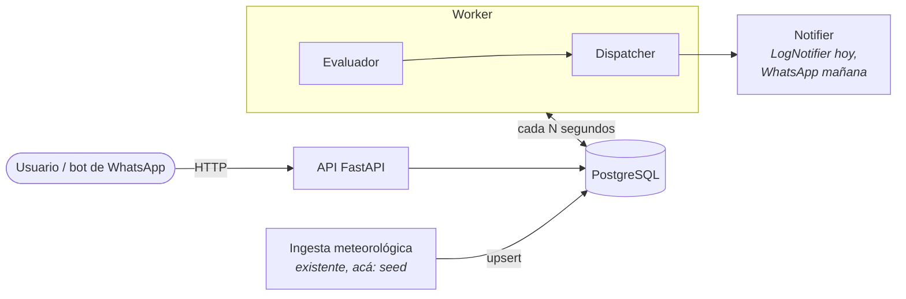
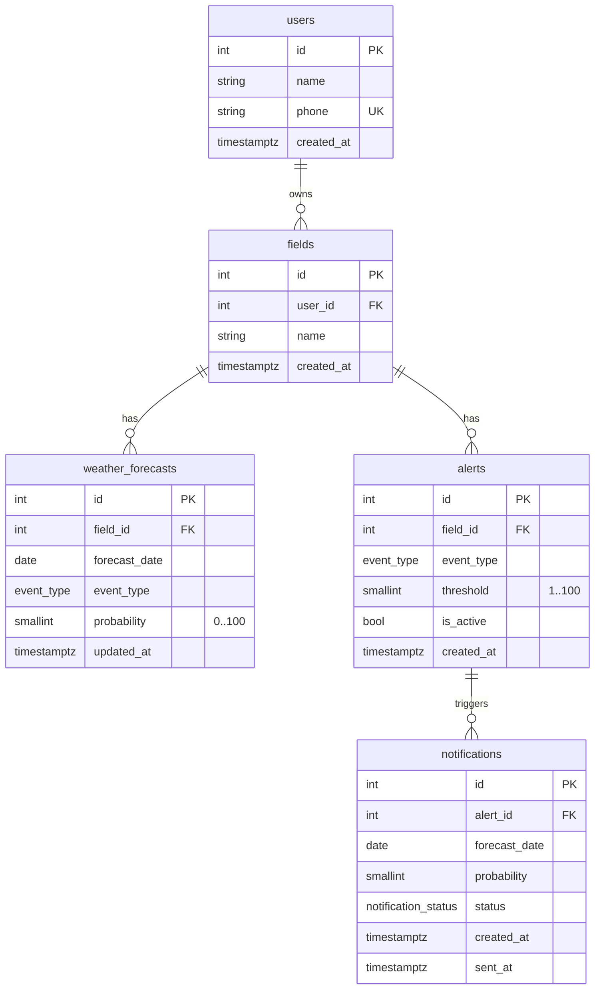
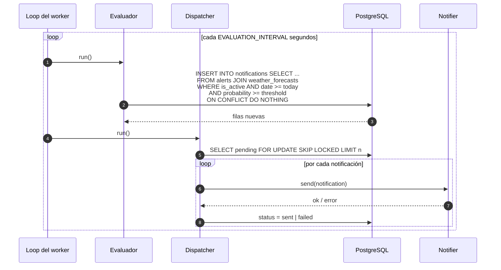
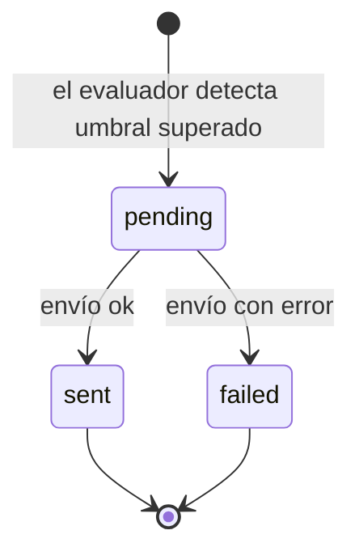
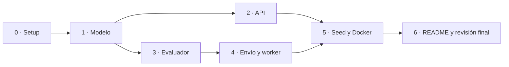
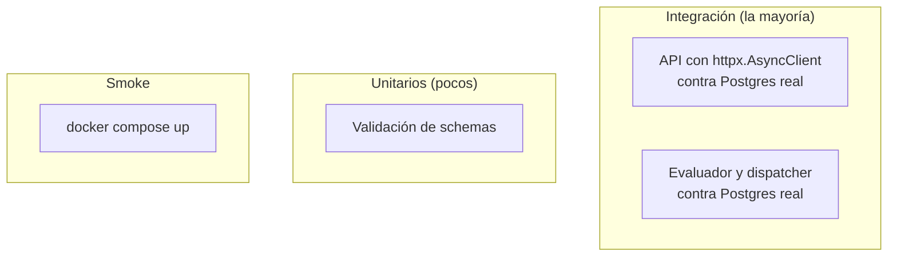

# Plan de trabajo — Sistema de Alertas Climáticas

Documento vivo. Cada tarea se tilda al cerrarse (tests en verde + revisión hecha).

- [1. Alcance](#1-alcance)
- [2. Arquitectura](#2-arquitectura)
- [3. Modelo de datos](#3-modelo-de-datos)
- [4. Flujo del job](#4-flujo-del-job)
- [5. API](#5-api)
- [6. Estructura del repo](#6-estructura-del-repo)
- [7. Fases](#7-fases)
- [8. Estrategia de tests](#8-estrategia-de-tests)
- [9. Revisiones](#9-revisiones)
- [10. Fuera de alcance](#10-fuera-de-alcance)

---

## 1. Alcance

Un usuario configura alertas sobre sus campos (tipo de evento + umbral de probabilidad).
Un job en background cruza periódicamente esas alertas con los pronósticos guardados y,
cuando un pronóstico supera el umbral, genera una notificación y la envía.

| Pide el challenge | Cómo lo resolvemos |
|---|---|
| Código production-ready | Migraciones, constraints en la base, config por env, logs, Docker, CI |
| Modelo de datos sólido | 5 tablas con FKs, uniques y checks; enum de eventos |
| Asincronía | SQLAlchemy async + asyncpg, worker asyncio |
| Endpoints | CRUD de alertas, alta de usuarios y campos, listado de notificaciones |
| Background job | Proceso `worker` que evalúa y despacha en loop |
| Datos meteorológicos mockeados | Script de seed |
| README, migraciones, tests | Fase 6, fase 1, todas las fases |

## 2. Arquitectura



Dos procesos con el mismo código: **api** y **worker**. Se comunican solo a través de la
base. El worker hace dos pasos separados:

1. **Evaluar**: detecta alertas superadas y deja una fila `pending` en `notifications`.
2. **Despachar**: toma las `pending`, las envía y las marca `sent` o `failed`.

Separarlos permite reintentar envíos sin volver a evaluar y correr varios workers sin
duplicar avisos.

## 3. Modelo de datos



Constraints clave:

| Tabla | Constraint | Para qué |
|---|---|---|
| `weather_forecasts` | `UNIQUE(field_id, forecast_date, event_type)` | Una entrada por día y evento; la ingesta hace upsert |
| `weather_forecasts` | `CHECK(probability BETWEEN 0 AND 100)` | |
| `alerts` | `UNIQUE(field_id, event_type)` | Una alerta por evento y campo |
| `alerts` | `CHECK(threshold BETWEEN 1 AND 100)` | |
| `notifications` | `UNIQUE(alert_id, forecast_date)` | **Idempotencia**: un aviso por alerta y día |
| todas | `ON DELETE CASCADE` en FKs hacia el padre | Borrar un campo limpia sus alertas |

Enums: `event_type = frost | rain | hail | strong_wind | heat_wave`,
`notification_status = pending | sent | failed`.

Índices: además de los uniques, `notifications(status)` parcial donde `status = 'pending'`.

## 4. Flujo del job



Estados de una notificación:



## 5. API

| Método | Ruta | Qué hace |
|---|---|---|
| `POST` | `/users` | Alta de usuario |
| `POST` | `/users/{user_id}/fields` | Alta de campo |
| `GET` | `/users/{user_id}/fields` | Campos del usuario |
| `POST` | `/fields/{field_id}/alerts` | Crear alerta (`event_type`, `threshold`) |
| `GET` | `/fields/{field_id}/alerts` | Alertas del campo |
| `PATCH` | `/alerts/{alert_id}` | Cambiar umbral o activar/desactivar |
| `DELETE` | `/alerts/{alert_id}` | Borrar alerta |
| `GET` | `/users/{user_id}/notifications` | Avisos del usuario, más nuevos primero |
| `GET` | `/health` | Liveness + ping a la base |

Errores: `404` si el padre no existe, `409` si la alerta ya existe para ese evento,
`422` validación de Pydantic.

## 6. Estructura del repo

```
app/
  main.py          # crea la app y registra routers
  config.py        # settings desde env
  db.py            # engine y sesión async
  models.py        # tablas SQLAlchemy
  schemas.py       # modelos Pydantic de entrada/salida
  routes/
    users.py
    alerts.py
    notifications.py
  alerts/
    evaluator.py   # la query de evaluación
    dispatcher.py  # envío de pendientes
    notifier.py    # interfaz Notifier + LogNotifier
  worker.py        # loop del job
  seed.py          # pronósticos mock
alembic/
tests/
docker-compose.yml
Dockerfile
pyproject.toml
README.md
```

Ningún archivo debería pasar ~150 líneas.

## 7. Fases



### Fase 0 — Setup
- [ ] `pyproject.toml` con uv, ruff y pytest configurados
- [ ] `docker-compose.yml` con Postgres
- [ ] `app/config.py` y `app/db.py`
- [ ] `app/main.py` con `/health`
- [ ] Fixture de tests: base de test, transacción por test con rollback
- [ ] CI de GitHub Actions: ruff + pytest con servicio Postgres
- **Test:** `/health` responde 200 con la base arriba
- **Revisión:** ¿la configuración tiene solo lo que se usa?

### Fase 1 — Modelo de datos
- [ ] `app/models.py` con las 5 tablas, enums y constraints
- [ ] Alembic inicializado (async) y primera migración
- **Test:** `upgrade head` y `downgrade base` corren limpios
- **Test:** los constraints rechazan datos inválidos (umbral 0, probabilidad 101, alerta duplicada)
- **Revisión:** el ER del código coincide con el de la sección 3

### Fase 2 — API
- [ ] Schemas Pydantic
- [ ] Rutas de usuarios y campos
- [ ] CRUD de alertas
- [ ] Listado de notificaciones
- **Test:** camino feliz de cada endpoint
- **Test:** 404 por padre inexistente, 409 por duplicado, 422 por umbral fuera de rango
- **Revisión:** ¿los handlers son finos? ¿algún endpoint que no se pidió?

### Fase 3 — Evaluador
- [ ] `evaluate()`: un solo `INSERT ... SELECT ... ON CONFLICT DO NOTHING`
- **Test:** probabilidad >= umbral genera aviso; menor no
- **Test:** alerta inactiva no genera aviso
- **Test:** fechas pasadas se ignoran
- **Test:** correr dos veces no duplica (idempotencia)
- **Test:** dos evaluaciones concurrentes no duplican
- **Revisión:** leer la query en voz alta; ¿se entiende sin comentarios?

### Fase 4 — Envío y worker
- [ ] `Notifier` (Protocol) + `LogNotifier`
- [ ] `dispatch()` con `FOR UPDATE SKIP LOCKED`
- [ ] `worker.py`: loop, intervalo por env, apagado limpio con SIGTERM
- **Test:** pendientes pasan a `sent`; si el notifier falla, a `failed`
- **Test:** un fallo no frena el resto del lote
- **Test:** un ciclo completo del worker (evaluar + despachar) con un notifier falso
- **Revisión:** ¿el worker sobrevive a un error de base en un ciclo?

### Fase 5 — Seed y Docker
- [ ] `seed.py`: usuarios, campos y pronósticos para los próximos 7 días
- [ ] `Dockerfile` único; `docker-compose.yml` con `db`, `migrate`, `api`, `worker`
- **Test:** `docker compose up` desde cero deja la API respondiendo y el worker
  generando avisos en los logs
- **Revisión:** seguir el README en una máquina limpia

### Fase 6 — README y cierre
- [ ] README: qué es, cómo correrlo, decisiones, qué faltó, mejoras futuras
- [ ] Diagramas finales (ER y flujo) en el README
- [ ] Revisión final completa (sección 9)

## 8. Estrategia de tests



- Postgres real en docker, nunca SQLite: usamos `ON CONFLICT`, enums y `SKIP LOCKED`.
- Cada test corre en una transacción que se descarta al final; no hay estado compartido.
- Fábricas mínimas en `conftest.py` (`make_user`, `make_field`...), sin librerías extra.
- Lo que no se testea: el `LogNotifier` (es un log) y el loop infinito en sí.

## 9. Revisiones

Al cerrar **cada fase**:

| Chequeo | Cómo |
|---|---|
| Tests y lint | `pytest` y `ruff` en verde, local y en CI |
| Minimalismo | ¿Hay algo que el challenge no pidió? Se saca o va a mejoras futuras |
| Legibilidad | Releer el diff como el entrevistador: cada archivo se entiende en una lectura |
| Tamaño | Ningún archivo > ~150 líneas, ninguna función > ~30 |
| Base de datos | Toda regla de integridad tiene su constraint |
| Commits | Chicos y con mensaje claro |

**Revisión final** (fase 6), además:
- Clonar el repo en limpio y seguir el README al pie de la letra.
- Revisar `git log` completo: que cuente la historia del proyecto.
- Lista de lo que faltó, honesta, en el README.

## 10. Fuera de alcance

Se documentan en el README como mejoras futuras, no se implementan:

- Integración real con WhatsApp.
- Autenticación (en producción la identidad la da el número validado por el bot).
- Pronósticos por ubicación compartida en lugar de por campo.
- Re-notificar si la probabilidad sube después del primer aviso.
- Reintentos automáticos con backoff para avisos `failed`.
- Paginación en listados.
