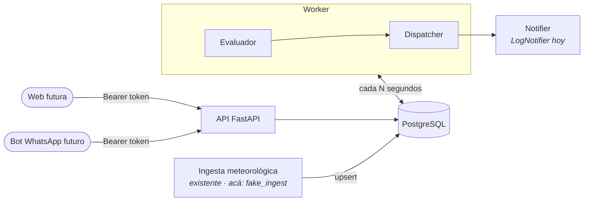
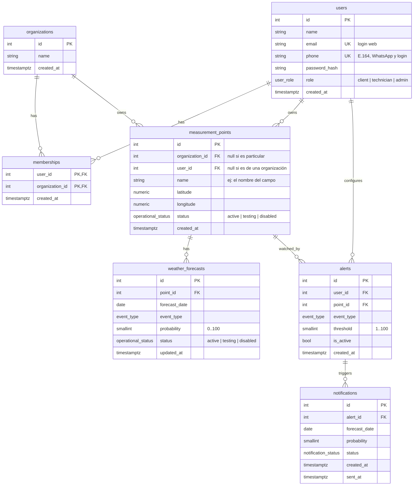
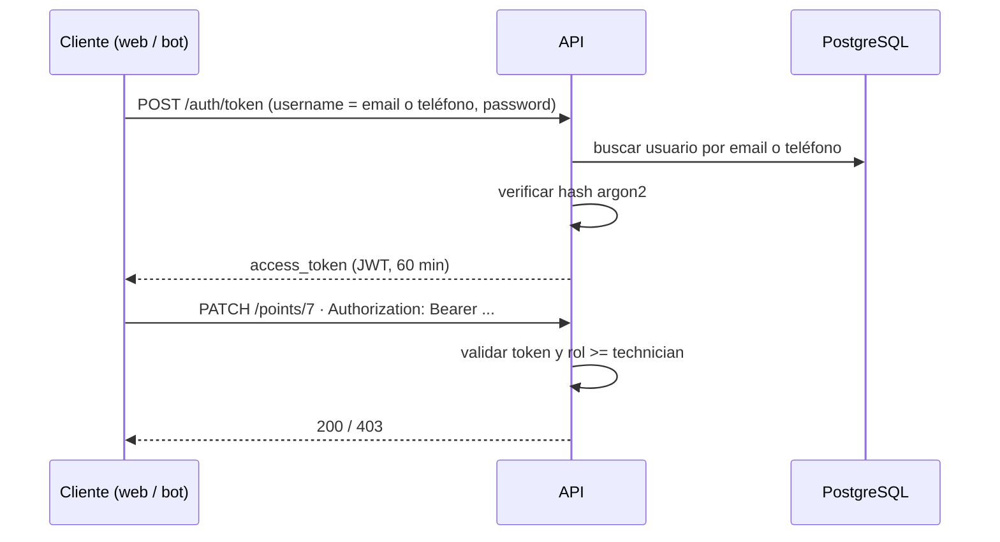
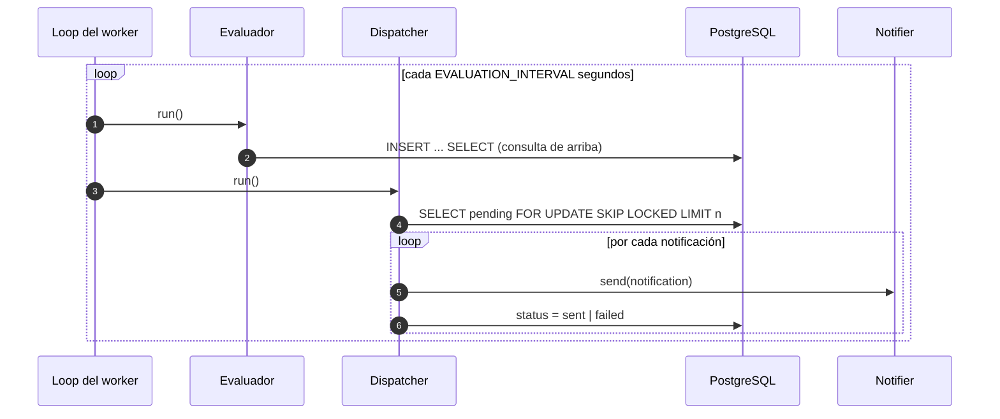
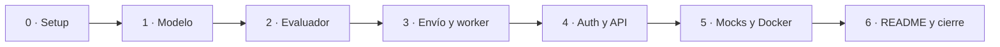

# Plan de trabajo — Sistema de Alertas Climáticas

Documento vivo. Cada tarea se tilda al cerrarse (tests en verde + revisión hecha).

- [1. Alcance](#1-alcance)
- [2. Arquitectura](#2-arquitectura)
- [3. Modelo de datos](#3-modelo-de-datos)
- [4. Autenticación y roles](#4-autenticación-y-roles)
- [5. Evaluación y re-notificación](#5-evaluación-y-re-notificación)
- [6. Mock de la ingesta](#6-mock-de-la-ingesta)
- [7. API](#7-api)
- [8. Estructura del repo](#8-estructura-del-repo)
- [9. Fases](#9-fases)
- [10. Estrategia de tests](#10-estrategia-de-tests)
- [11. Revisiones](#11-revisiones)
- [12. Fuera de alcance](#12-fuera-de-alcance)
- [13. Preguntas para el cliente](#13-preguntas-para-el-cliente)

---

## 1. Alcance

Los usuarios tienen puntos de medición propios o compartidos a través de organizaciones
(un establecimiento, una empresa). Cada usuario configura alertas sobre los puntos que
ve: tipo de evento climático y umbral de probabilidad. Un job en background cruza las
alertas con las muestras (los pronósticos guardados) y avisa al usuario cuando se supera
el umbral, y otra vez si la probabilidad sigue subiendo.

Hay tres tipos de usuario: **clientes**, que consultan y configuran sus alertas, y
**técnicos** y **administradores**, que gestionan puntos, organizaciones y muestras.
Puntos y muestras pueden estar **en testing** o **inhabilitados**: el cliente no los ve
y no disparan alertas.

La API se diseña pensando en un cliente web a futuro: login con email o teléfono,
token Bearer y CORS configurable. El bot de WhatsApp sería otro cliente de la misma API.

| Pide el challenge | Cómo lo resolvemos |
|---|---|
| Código production-ready | Migraciones, constraints en la base, auth con roles, config por env, logs, Docker, CI |
| Modelo de datos sólido | 7 tablas con FKs, uniques, checks, enums y un trigger |
| Asincronía | SQLAlchemy async + asyncpg, worker asyncio |
| Endpoints | Auth, usuarios, organizaciones, puntos, muestras, alertas, notificaciones |
| Background job | Proceso `worker` que evalúa y despacha en loop |
| Datos meteorológicos mockeados | `seed` + `fake_ingest` que imita al job existente |
| README, migraciones, tests | Fase 6, fase 1, todas las fases |

## 2. Arquitectura



Dos procesos con el mismo código, **api** y **worker**, que solo se hablan a través de
la base. El worker hace dos pasos separados:

1. **Evaluar**: detecta alertas superadas y deja una fila `pending` en `notifications`.
2. **Despachar**: toma las `pending`, las envía y las marca `sent` o `failed`.

Separarlos permite reintentar envíos sin volver a evaluar y correr varios workers sin
duplicar avisos.

## 3. Modelo de datos



Cada fila de `weather_forecasts` es una **muestra**: la probabilidad de un evento para un
día en un punto, tal como la deja la ingesta.

Quién es dueño de qué:

- **Un usuario puede estar en varias organizaciones** (ej. un agrónomo que asesora
  varios campos) a través de `memberships`. Una organización puede existir sin miembros.
- **Un punto es de una organización o de un usuario**, nunca de los dos.
- **Las alertas son de cada usuario**, sobre cualquier punto que pueda ver, y el aviso
  le llega a él.
- **La ingesta escribe** `weather_forecasts`; lee `measurement_points` para saber qué
  coordenadas consultar.

Qué ve cada uno:

| | Puntos | Muestras |
|---|---|---|
| Cliente | Sus particulares y los de sus organizaciones, solo `active` | Solo `active` de esos puntos |
| Técnico / admin | Todos, en cualquier estado | Todas, en cualquier estado |

Las reglas de visibilidad viven en una sola consulta de "puntos visibles" que reusan
todas las rutas.

### Estado de puntos y muestras

Un solo enum `operational_status = active | testing | disabled` para los dos.

- Un técnico pone un punto en `testing` mientras se instala o calibra, o en `disabled`
  si deja de usarse.
- **Cada lectura nueva toma el estado actual del punto.** Lo hace un trigger de Postgres
  (`sync_sample_status`, `BEFORE INSERT OR UPDATE` en `weather_forecasts`): la ingesta es
  un sistema externo que no controlamos, así que la regla tiene que vivir en la base y no
  en nuestro código. Una lectura es cualquier escritura de la ingesta, aunque repita el
  valor.
- **Lo que llegó durante el testing sigue siendo dato de prueba.** Activar un punto no
  toca lo que ya tenía: un valor disparatado de un sensor en calibración no dispara
  alertas cuando el punto pasa a activo. Las lecturas siguientes sí cuentan.
- Un técnico puede marcar una muestra puntual como `testing` o `disabled` (ej. un valor
  anómalo). La marca vale para esa lectura y dura hasta la siguiente. Mientras el punto no
  esté activo, sus muestras no se pueden activar.
- El mismo trigger mantiene `updated_at`, porque la ingesta no pasa por el ORM.
- **Solo muestras `active` de puntos `active` disparan alertas.**

Constraints clave:

| Tabla | Constraint | Para qué |
|---|---|---|
| `users` | `UNIQUE(phone)`, `UNIQUE(lower(email))` | Identifican al usuario en el login, sin importar mayúsculas |
| `users` | `CHECK(phone ~ E.164)` | El teléfono sirve para WhatsApp |
| `memberships` | `PRIMARY KEY(user_id, organization_id)` | Sin membresías repetidas |
| `measurement_points` | `CHECK(num_nonnulls(organization_id, user_id) = 1)` | Exactamente un dueño |
| `measurement_points` | `UNIQUE(organization_id, name)`, `UNIQUE(user_id, name)` | Nombres sin repetir por dueño (los `NULL` no chocan entre sí) |
| `weather_forecasts` | `UNIQUE(point_id, forecast_date, event_type)` | Una muestra por día y evento; la ingesta hace upsert |
| `weather_forecasts` | `CHECK(probability BETWEEN 0 AND 100)` | |
| `weather_forecasts` | trigger `sync_sample_status` | Estado de las muestras y `updated_at` (ver arriba) |
| `alerts` | `UNIQUE(user_id, point_id, event_type)` | Una alerta por usuario, punto y evento |
| `alerts` | `CHECK(threshold BETWEEN 1 AND 100)` | |
| `notifications` | `UNIQUE(alert_id, forecast_date, probability)` | Idempotencia: el mismo aviso nunca se genera dos veces |
| todas | `ON DELETE CASCADE` hacia el padre | Borrar un punto limpia sus muestras y alertas |

Índices además de los de PK y unique: `alerts(point_id)` para el evaluador,
`memberships(organization_id)` para listar miembros y `notifications(id) WHERE status =
'pending'` para el dispatcher.

Enums: `user_role = client | technician | admin`, `operational_status = active | testing | disabled`,
`event_type = frost | rain | hail | strong_wind | heat_wave`,
`notification_status = pending | sent | failed`.

## 4. Autenticación y roles



- **Login con email o teléfono + contraseña.** La web usaría email y WhatsApp el
  teléfono; la API acepta cualquiera de los dos en el campo `username`.
- **Teléfono y email obligatorios.** Los avisos salen por WhatsApp; el email queda
  para la web y para un futuro canal de avisos.
- **Contraseñas con argon2** (`pwdlib`), **tokens JWT** (`PyJWT`) firmados con una clave
  de entorno. Flujo OAuth2 password estándar de FastAPI: funciona en el botón
  *Authorize* de `/docs` y en cualquier SPA.
- **CORS** configurable por entorno para la futura web.

Roles globales y acumulativos: cada uno puede todo lo del anterior.

| Rol | Puede |
|---|---|
| `client` | Consultar sus puntos y muestras; gestionar sus propias alertas y ver sus avisos |
| `technician` | + crear y modificar organizaciones, miembros y puntos; cambiar el estado de puntos y muestras |
| `admin` | + eliminar; cambiar el rol de un usuario |

- Se chequea con una sola dependencia, `require_role(Role.technician)`. Los roles son un
  enum ordenado, así que el chequeo es una comparación.
- `/auth/register` es público y siempre crea un `client` **sin organizaciones**: si
  aceptara `organization_ids`, cualquiera podría sumarse a cualquier organización.
  Para crear un usuario ya dentro de organizaciones está `POST /users`, que pide técnico.
- `POST /organizations` acepta `member_ids` para crearla con miembros en una sola
  llamada. Organización y membresías se insertan en la misma transacción.
- El primer admin se crea con un comando
  (`python -m app.create_admin`); después los admins promueven a otros.
- Los puntos particulares de un cliente los crea un técnico, igual que los de una
  organización: el cliente solo consulta.
- Sin acceso a un recurso que no ve → `404`, para no revelar que existe. Ve el recurso
  pero su rol no alcanza para la acción → `403`.

## 5. Evaluación y re-notificación

Regla: se avisa cuando la probabilidad alcanza el umbral, y **se vuelve a avisar si sube
al menos `RENOTIFY_STEP` puntos** (por defecto 15) sobre el último aviso de esa alerta y
ese día. Si baja, no se avisa.

> Umbral 60 · pronóstico 65 → aviso · sube a 70 → nada · sube a 85 → aviso

Todo es una sola consulta:

```sql
INSERT INTO notifications (alert_id, forecast_date, probability)
SELECT a.id, f.forecast_date, f.probability
FROM alerts a
JOIN measurement_points p ON p.id = a.point_id
JOIN weather_forecasts f
  ON f.point_id = a.point_id AND f.event_type = a.event_type
LEFT JOIN LATERAL (
  SELECT max(n.probability) AS last_notified
  FROM notifications n
  WHERE n.alert_id = a.id AND n.forecast_date = f.forecast_date
) prev ON true
WHERE a.is_active
  AND p.status = 'active'
  AND f.status = 'active'
  AND f.forecast_date >= :today
  AND f.probability >= a.threshold
  AND (prev.last_notified IS NULL OR f.probability >= prev.last_notified + :step)
ON CONFLICT DO NOTHING;
```

- Solo muestras `active` de puntos `active`: los datos de prueba nunca avisan a nadie.
- Solo se avisa cuando la probabilidad sube, así que el máximo notificado es siempre
  el último aviso.
- Si dos workers evalúan a la vez, calculan la misma fila y el `UNIQUE` hace que la base
  rechace la segunda.
- `:today` se calcula en la zona horaria configurada (`TIMEZONE`), no en UTC: a las
  22 h en Argentina, en UTC ya es mañana.



## 6. Mock de la ingesta

El job de ingesta ya existe en el sistema real; acá lo reemplazamos con dos comandos que
**no son parte de la solución** y viven aparte (`app/mocks/`):

| Comando | Qué hace | Cuándo corre |
|---|---|---|
| `python -m app.mocks.seed` | Un admin, un técnico y dos clientes; una organización con puntos compartidos, un punto particular y uno en testing; algunas alertas | Una vez |
| `python -m app.mocks.fake_ingest` | Upsert de pronósticos de los próximos 7 días para cada punto. Las probabilidades se mueven de a poco en cada pasada | En loop, como servicio de compose |

Como las probabilidades cambian con el tiempo, con `docker compose up` se ve en los logs
del worker tanto el primer aviso como las re-notificaciones. Los tests no usan el mock:
cargan sus pronósticos a mano para ser deterministas.

## 7. API

Todas las rutas salvo `/auth/*` y `/health` piden `Authorization: Bearer <token>`.
La columna **Rol** es el mínimo necesario.

| Método | Ruta | Rol | Qué hace |
|---|---|---|---|
| `POST` | `/auth/register` | — | Crear usuario `client` (nombre, teléfono, email, contraseña) |
| `POST` | `/auth/token` | — | Login con email o teléfono, devuelve el token |
| `GET` | `/me` | client | Usuario actual, rol y organizaciones |
| `GET` | `/users` | technician | Listar usuarios |
| `POST` | `/users` | technician | Crear usuario, opcionalmente ya dentro de organizaciones (`organization_ids`) |
| `PATCH` | `/users/{id}` | admin | Cambiar rol |
| `DELETE` | `/users/{id}` | admin | Eliminar usuario |
| `GET` | `/organizations` | client | Las mías (técnico/admin: todas) |
| `POST` | `/organizations` | technician | Crear organización, opcionalmente con miembros (`member_ids`) |
| `PATCH` | `/organizations/{id}` | technician | Renombrar |
| `DELETE` | `/organizations/{id}` | admin | Eliminar |
| `GET` | `/organizations/{id}/members` | client | Miembros |
| `POST` | `/organizations/{id}/members` | technician | Sumar un usuario |
| `DELETE` | `/organizations/{id}/members/{user_id}` | technician | Quitar un usuario |
| `GET` | `/points` | client | Puntos visibles |
| `POST` | `/points` | technician | Crear punto (de una organización o de un usuario) |
| `PATCH` | `/points/{id}` | technician | Nombre, coordenadas, estado |
| `DELETE` | `/points/{id}` | admin | Eliminar punto |
| `GET` | `/points/{id}/forecasts` | client | Muestras del punto (cliente: solo `active`), filtrable por fecha |
| `PATCH` | `/forecasts/{id}` | technician | Cambiar estado de una muestra |
| `DELETE` | `/forecasts/{id}` | admin | Eliminar una muestra |
| `GET` | `/alerts` | client | Mis alertas |
| `POST` | `/alerts` | client | Crear alerta (punto visible, evento, umbral) |
| `PATCH` | `/alerts/{id}` | client | Cambiar umbral o activar/desactivar |
| `DELETE` | `/alerts/{id}` | client | Borrar alerta |
| `GET` | `/notifications` | client | Mis avisos, más nuevos primero (`limit`, `offset`) |
| `GET` | `/health` | — | Liveness + ping a la base |

Errores: `401` sin token o token inválido, `403` rol insuficiente, `404` no existe o no
lo veo, `409` duplicado, `422` validación.

## 8. Estructura del repo

```
app/
  main.py            # crea la app, CORS y routers
  config.py          # settings desde env
  db.py              # engine y sesión async
  models.py          # tablas SQLAlchemy
  schemas.py         # modelos Pydantic
  auth.py            # hash, JWT, current_user y require_role
  create_admin.py    # comando para crear el primer admin
  routes/
    auth.py
    users.py
    organizations.py
    points.py
    forecasts.py
    alerts.py
    notifications.py
  jobs/
    evaluator.py     # la consulta de evaluación
    dispatcher.py    # envío de pendientes
    notifier.py      # Notifier (Protocol) + LogNotifier
  worker.py          # loop del job
  mocks/
    seed.py
    fake_ingest.py
alembic/
tests/
docker-compose.yml
Dockerfile
pyproject.toml
README.md
```

Ningún archivo debería pasar ~150 líneas.

## 9. Fases



El núcleo del challenge (evaluar y avisar) va primero: si falta tiempo, lo que queda
afuera es gestión, no lo que se evalúa.

### Fase 0 — Setup
- [x] `pyproject.toml` con uv, ruff y pytest configurados
- [x] `Dockerfile` (Python 3.12 + uv) y `docker-compose.yml` con Postgres y la API
- [x] Todo corre con `docker compose`; `uv` local es opcional para el editor y correr tests rápido
- [x] `app/config.py` y `app/db.py`
- [x] `app/main.py` con `/health`
- [x] Fixture de tests: base de test, transacción por test con rollback
- [x] CI de GitHub Actions: ruff + pytest con servicio Postgres
- **Test:** `/health` responde 200 con la base arriba
- **Revisión:** ¿la configuración tiene solo lo que se usa?

### Fase 1 — Modelo de datos
- [x] `app/models.py` con las 7 tablas, enums y constraints
- [x] Alembic inicializado (async) y primera migración, con el trigger de estado
- **Test:** `upgrade head` y `downgrade base` corren limpios
- **Test:** los constraints rechazan datos inválidos (umbral 0, probabilidad 101, duplicados, punto sin dueño)
- **Test:** reglas de estado de las muestras, con upserts como los de la ingesta
- **Revisión:** el código coincide con el diagrama de la sección 3

### Fase 2 — Evaluador
- [x] `evaluate()`: la consulta de la sección 5
- **Test:** probabilidad >= umbral genera aviso; menor no
- **Test:** alerta inactiva no genera aviso; fechas pasadas se ignoran
- **Test:** muestras en testing o disabled, o de puntos no activos, no generan aviso
- **Test:** correr dos veces sin cambios no duplica
- **Test:** sube menos que `RENOTIFY_STEP` → nada; sube más → segundo aviso; baja → nada
- **Test:** dos evaluaciones concurrentes no duplican
- **Test:** `today` respeta `TIMEZONE`
- **Revisión:** ¿la consulta se entiende sin comentarios?

### Fase 3 — Envío y worker
- [x] `Notifier` (Protocol) + `LogNotifier`
- [x] `dispatch()` con `FOR UPDATE SKIP LOCKED`
- [x] `worker.py`: loop, intervalo por env, apagado limpio con SIGTERM. `EVALUATION_INTERVAL`
  por defecto 60 s; conviene alinearlo con la frecuencia real de la ingesta. En la demo,
  el worker y `fake_ingest` comparten un mismo intervalo de 10 s
- **Test:** pendientes pasan a `sent`; si el notifier falla, a `failed`
- **Test:** un fallo no frena el resto del lote
- **Test:** un ciclo completo (evaluar + despachar) con un notifier falso
- **Revisión:** ¿el worker sobrevive a un error de base en un ciclo?

### Fase 4 — Auth y API
- [x] `app/auth.py`: hash argon2, emitir y validar JWT, `current_user`, `require_role`
- [x] `create_admin.py`
- [x] `/auth/register`, `/auth/token` (email o teléfono), `/me`
- [x] Usuarios (listar, crear con organizaciones, cambiar rol, eliminar)
- [x] Organizaciones (crear con miembros) y miembros
- [x] Puntos de medición particulares y de organización, con estado
- [x] Muestras: consultar, cambiar estado, eliminar
- [x] CRUD de alertas
- [x] Listado de notificaciones paginado
- [x] CORS por entorno
- **Test:** registro, login con email y con teléfono, contraseña incorrecta, token vencido o adulterado
- **Test:** camino feliz de cada endpoint
- **Test:** crear organización con un `member_id` inexistente no deja nada a medias
- **Test:** permisos: cada endpoint con el rol justo debajo del mínimo devuelve 403
- **Test:** aislamiento: un cliente no ve puntos ajenos, puntos o muestras que no estén `active`, ni alertas o avisos de otros
- **Test:** 409 por duplicados, 422 por umbral fuera de rango
- **Revisión:** ¿handlers finos? ¿algún endpoint que no se pidió?

### Fase 5 — Mocks y Docker
- [x] `mocks/seed.py` y `mocks/fake_ingest.py`
- [x] Compose completo: sumar `worker` y `fake_ingest` (`migrate` ya está desde la fase 1)
- **Test:** `docker compose up` desde cero deja la API respondiendo y el worker
  avisando y re-avisando en los logs
- **Revisión:** seguir el README en una máquina limpia

### Fase 6 — README y cierre
- [ ] README: qué es, cómo correrlo, decisiones, qué faltó, mejoras futuras
- [ ] Diagramas finales (modelo y flujo) en el README
- [ ] Revisión final completa (sección 11)

## 10. Estrategia de tests

- Integración contra Postgres real en docker, nunca SQLite: usamos `ON CONFLICT`,
  `LATERAL`, enums y `SKIP LOCKED`.
- Cada test corre en una transacción que se descarta al final; no hay estado compartido.
- API con `httpx.AsyncClient`; un fixture da un cliente ya autenticado.
- Fábricas mínimas en `conftest.py` (`make_user`, `make_org`, `make_point`...), sin
  librerías extra.
- Lo que no se testea: `LogNotifier` (es un log), el loop infinito y los mocks.

## 11. Revisiones

Al cerrar **cada fase**:

| Chequeo | Cómo |
|---|---|
| Tests y lint | `pytest` y `ruff` en verde, local y en CI |
| Minimalismo | ¿Hay algo que el challenge no pidió? Se saca o va a mejoras futuras |
| Legibilidad | Releer el diff como un revisor externo: cada archivo se entiende en una lectura |
| Tamaño | Ningún archivo > ~150 líneas, ninguna función > ~30 |
| Base de datos | Toda regla de integridad que se pueda expresar tiene su constraint |
| Seguridad | Todo endpoint tiene `current_user` o `require_role`; todo acceso a puntos pasa por la consulta de puntos visibles |
| Commits | Chicos y con mensaje claro |

**Revisión final** (fase 6), además:
- Clonar el repo en limpio y seguir el README al pie de la letra.
- Revisar `git log` completo: que cuente la historia del proyecto.
- Lista honesta de lo que faltó en el README.

## 12. Fuera de alcance

Se documentan en el README como mejoras futuras, no se implementan:

- **Permisos por organización y por punto**: hoy el rol es global. A futuro, un sistema
  de permisos donde un usuario tenga distintos roles o permisos según la organización o
  el punto de medición (ej. admin de su establecimiento, cliente en otro).
- Integración real con WhatsApp (el bot sería un cliente más de la API).
- Invitaciones con aceptación para sumarse a una organización.
- Refresh tokens, recuperación de contraseña, verificación de email y teléfono.
- Avisar cuando la probabilidad baja ("ya no se espera helada").
- Reintentos automáticos con backoff para avisos `failed`.
- Evaluar apenas la ingesta escribe, con `LISTEN/NOTIFY` de Postgres, en vez de un
  intervalo fijo.
- Historial de quién cambió el estado de un punto o una muestra.

## 13. Preguntas para el cliente

Decisiones de producto que tomamos con un supuesto razonable y conviene validar con quien
va a usar el sistema:

- **Puntos en testing:** hoy están ocultos para el cliente. ¿Prefiere verlos (ej. "en
  instalación") aunque sin muestras?
- **Canal de avisos:** hoy todos salen por WhatsApp. ¿Hay usuarios que preferirían
  recibirlos por email?
- **Re-notificación:** ¿15 puntos de subida es un buen salto, o depende del evento
  (una helada al 40% ya preocupa)?
- **Zona horaria:** ¿todos los campos están en Argentina, o hace falta zona horaria por
  punto?
- **Puntos particulares:** ¿un cliente debería poder dar de alta sus propios puntos, o
  siempre los instala un técnico?
